# Diagramas Mermaid del Email Engine

Estos diagramas van en Notion (uno por página) y en docs. Están validados para el renderer de Mermaid. Copiar el bloque tal cual.

Convención de colores:
- Azul (`#0CB7F2`) = eje / core
- Verde (`#1BB673`) = clave / alto ROI
- Morado (`#7C5CFF`) = loop / data
- Ámbar (`#F5A623`) = optimización
- Gris (`#9DB4BE`) = sistema / al final

---

## GLOBAL · El engine completo (las 8 fases)

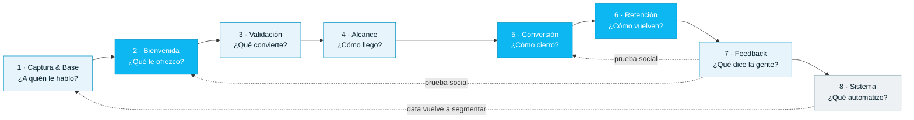

---

## GLOBAL · Flywheel (cómo se acelera)

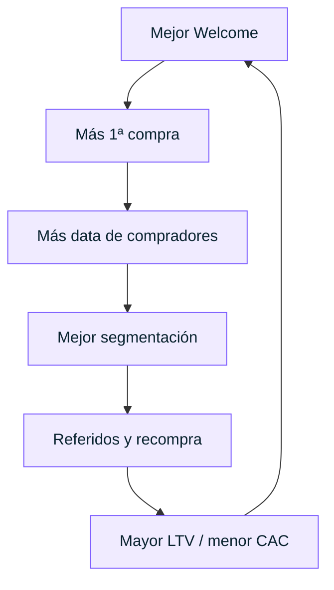

---

## FASE 1 · Captura & Base

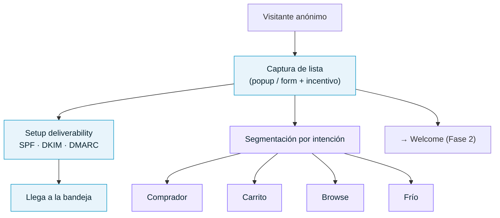

---

## FASE 2 · Bienvenida

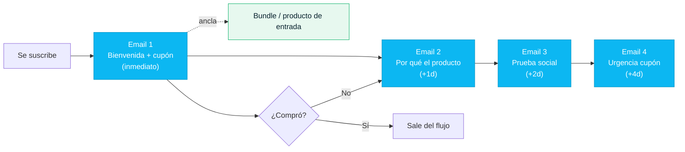

---

## FASE 3 · Validación

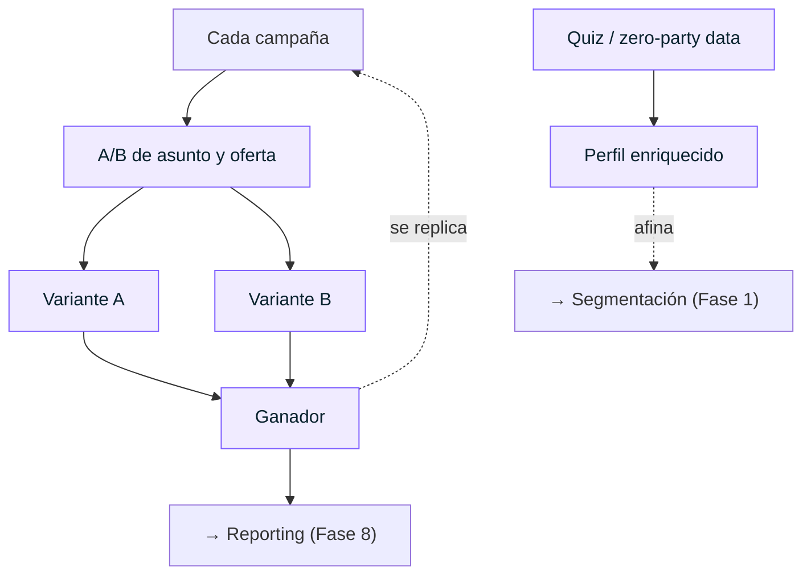

---

## FASE 4 · Alcance

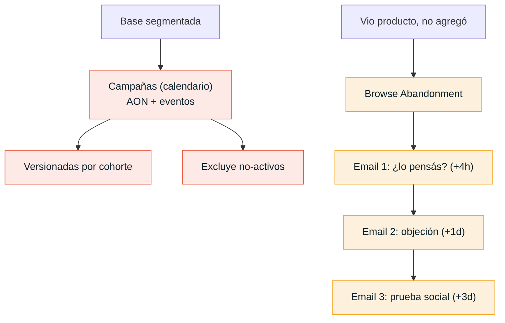

---

## FASE 5 · Conversión

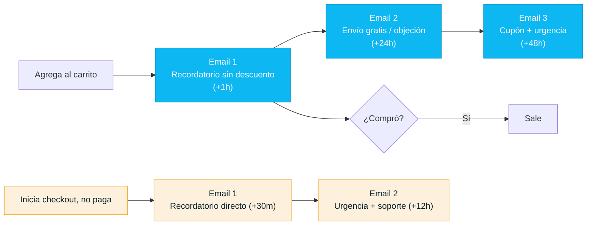

---

## FASE 6 · Retención

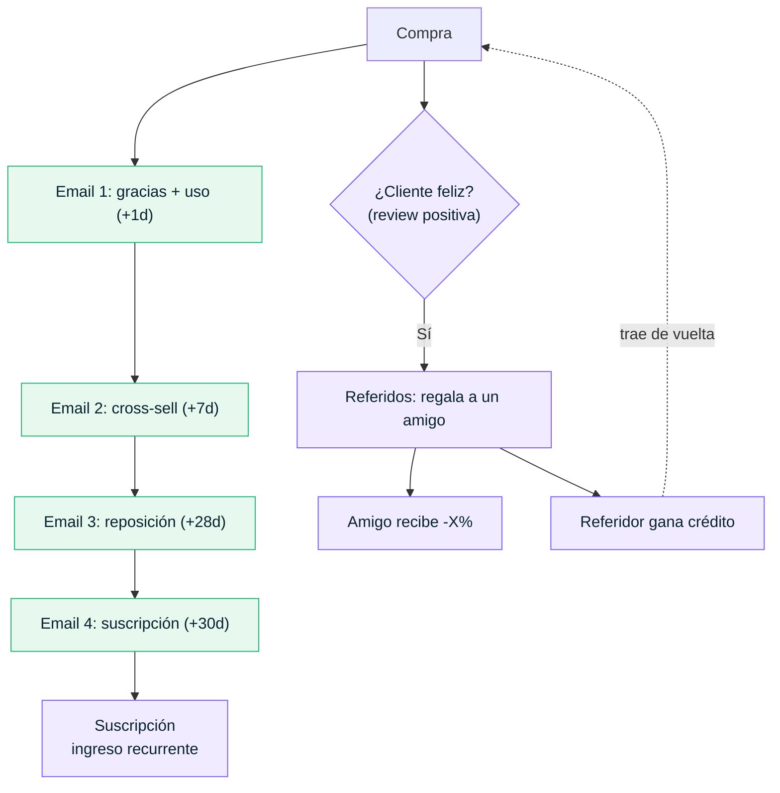

---

## FASE 7 · Feedback

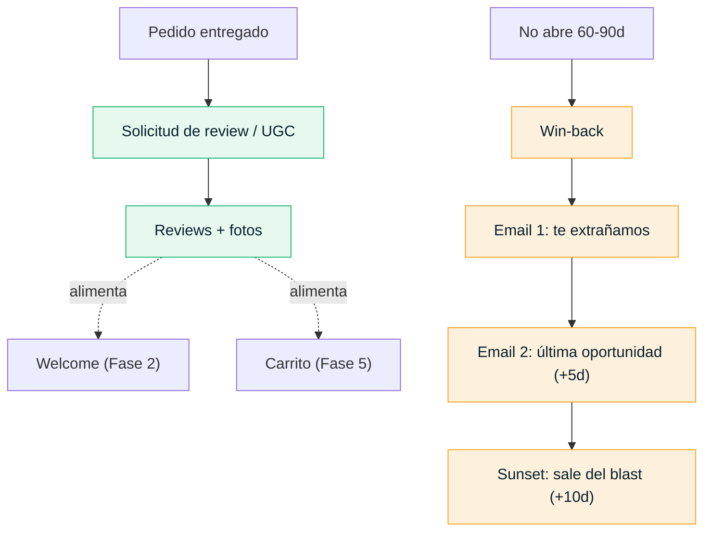

---

## FASE 8 · Sistema

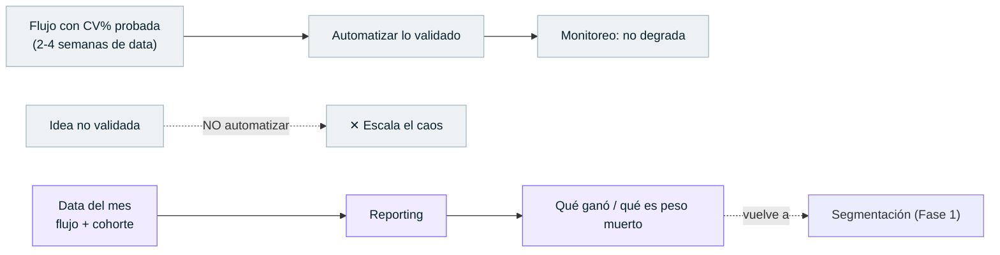

---

## ESCALAMIENTO · Acciones por facturación

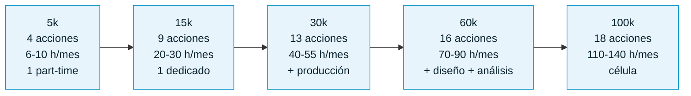

---

## DEPENDENCIAS · Email dentro del Growth Engine

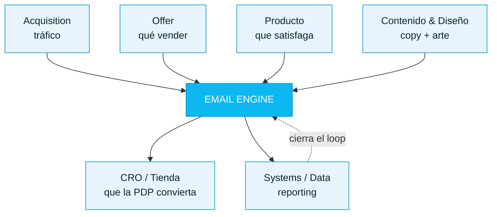
